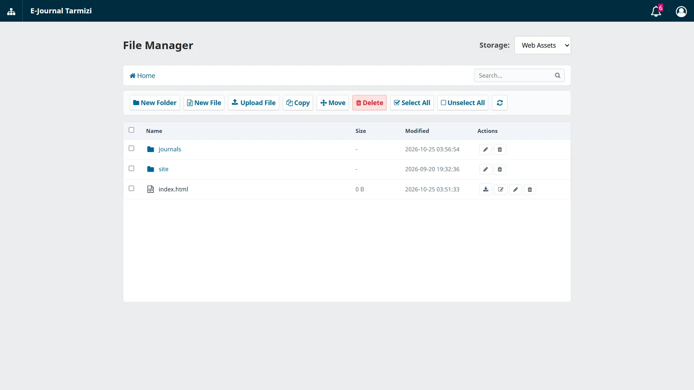

# OJS File Manager Plugin

[](https://www.php.net/)
[](https://developer.mozilla.org/en-US/docs/Web/JavaScript)
[](https://developer.mozilla.org/en-US/docs/Web/CSS)
[](https://developer.mozilla.org/en-US/docs/Web/HTML)
[](https://pkp.sfu.ca/ojs/)
[](LICENSE)

A native File Manager plugin for Open Journal Systems (OJS) 3.4+. Designed to provide Site Administrators with secure, direct management of OJS installation files and directories from the administration panel.



---

## Key Features

- **Site Administration Integration**: Accessible directly from Site Administration (`/admin/filemanager`).
- **File & Directory Navigation**: Fast directory browsing with interactive breadcrumb navigation.
- **File Operations**:
  - Create new folders (*New Folder*).
  - Create new files (*New File*).
  - Upload files (*Upload*).
  - In-browser code and text editing (*Edit & Save*).
  - Rename, download, and delete files or folders.
- **Real-Time Search**: Recursive search across directories with instant filtering.
- **Cross-Platform Compatibility**: Fully compatible with Linux and Windows server environments (path normalization, case sensitivity handling, and illegal character filtering).
- **Security Hardening**:
  - Restricted strictly to the Site Administrator role (`ROLE_ID_SITE_ADMIN`).
  - Strict CSRF token validation across all state-modifying actions.
  - Path traversal protection (canonical path boundary checks, blocking `../` exploits).
  - Executable script upload protection (blocking `.php`, `.phtml`, `.htaccess`, `.env`, web shells).
  - File content sanitization (SVG/HTML inline script and XSS payload detection).
  - Critical system files protected from deletion or renaming.

---

## System Requirements

- Open Journal Systems (OJS) 3.4.0 or higher
- PHP 8.0, 8.1, 8.2, 8.3, or 8.4
- Write permissions on managed storage directories

---

## Installation

1. Clone the repository into your OJS plugins directory:
   ```bash
   git clone https://github.com/openjournalcenter/ojs-file-manager.git plugins/generic/fileManager
   ```
   *Or download the release archive and extract it to `plugins/generic/fileManager`.*

2. Ensure correct directory permissions for your web server (Apache/Nginx):
   ```bash
   chmod -R 755 plugins/generic/fileManager
   ```

3. Log in to OJS as **Site Administrator**.

4. Go to **Settings > Website > Plugins > Installed Plugins**, find **File Manager Plugin**, and enable the checkbox.

5. Open the File Manager from the **Administration > File Manager** menu or the action panel on the **Site Administration** page.

---

## Authors & Maintainers

- **Author**: Dimar Tarmizi
- **Organization**: [Open Journal Center](https://github.com/openjournalcenter)
- **Repository**: [https://github.com/openjournalcenter/ojs-file-manager](https://github.com/openjournalcenter/ojs-file-manager)

---

## License

This plugin is licensed under the [GNU General Public License v3.0](LICENSE).
